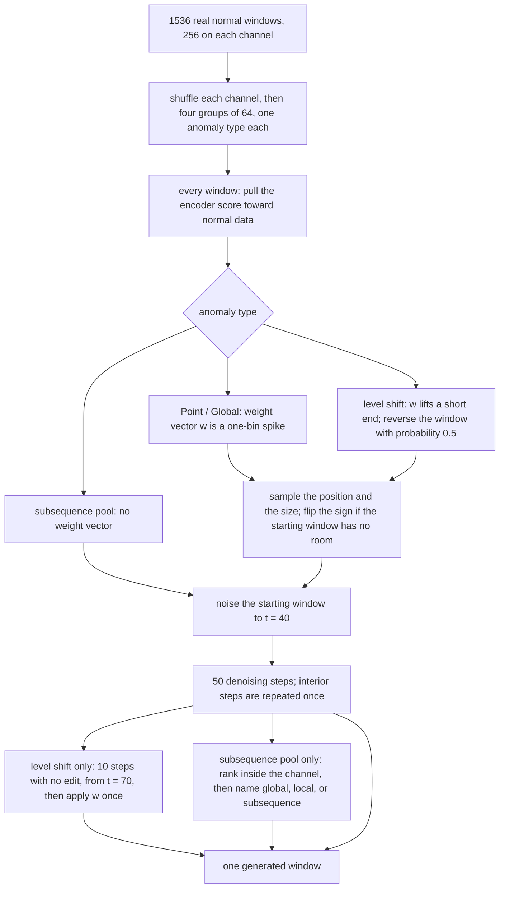
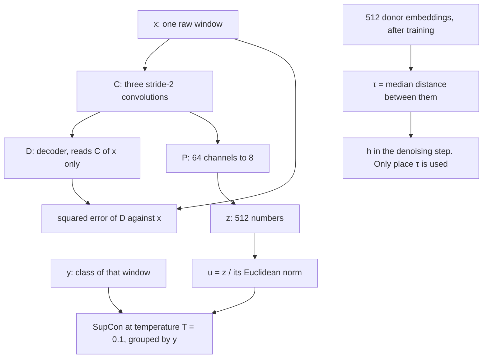
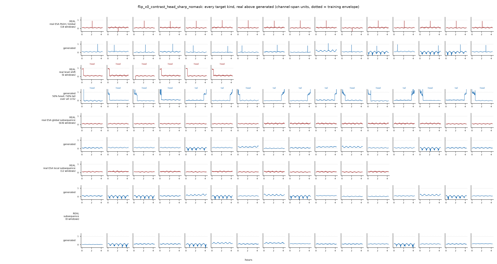

# `flip_x0_contrast_head_sharp_nomask`

This is the current way an anomalous window is built. No new network is trained. The denoiser, the encoder, the noise schedule, and the real normal windows are the ones already used by the earlier baseline (C1 in the code). What changes is the edit subtracted from the denoiser's guess of the clean window. No time bin is held fixed, so the whole window can change, and the run does not save a per-bin label of where the anomaly is. Longer comparisons: [MODEL_CONTRAST_HEAD.md](MODEL_CONTRAST_HEAD.md), [ESA_RUN_2026-10-06.md](ESA_RUN_2026-10-06.md) §11.

## What one run produces

One run writes **1536 windows**. Each window is an edit of one real telemetry window that has no annotated anomaly. There are 256 such starting windows on each of the six channels, 41–46. Other notes call the batch of 1536 results a gallery, and each starting window a donor.

The 256 starting windows of a channel are shuffled and cut into four groups of 64. Each group is given a name before sampling, so each edit sees every channel. Point/Global and level shift then use different weight vectors. The two subsequence names share one edit. After the windows are finished, those two groups are pooled and named again, 256 windows each: global, local, or subsequence.

Every window, of every type, is pulled by the normal-score term: the encoder's score is steered toward the score reached only by the most unusual 1% of normal windows. A second pull is switched off. That pull would have moved the window toward the encoder vector of one stored real anomaly, which also copied that anomaly's position into the result. The code calls the second pull the prototype term.

Point/Global and level shift add a contrast on top of that pull. A contrast is one number, d(x) = Σ_t w[t]·x[t], with a hand-written weight vector w. For those windows the run samples where the shape sits, how large d should be, and, for a level shift, which end of the window is the short shifted side. The size is copied from a real anomaly of the same type whose event is not in the current test fold. If the starting window has no room to move in the sampled direction, the sign of the size is flipped and the size itself is kept. After the guided steps, a level-shift window is noised a short way and denoised again with no edit, then the contrast is applied once more. That extra pass is there to replace the rough residue with normal-looking texture.



The direct arrow from the denoising steps to the output is the spike. The subsequence pool is named after those steps. Only the level shift takes the extra texture pass.

## One denoising step

The chain starts from a lightly noised starting window and takes 50 steps. Each step except the last is done twice, the second time from a freshly noised copy. The contrast is applied at full strength on every step. The normal-score pull is larger while more noise remains, and those weights average to 1. On the last step the whole edit is multiplied by 0.25, so a full contrast step hits the target size and the delivered window keeps only a quarter of the last correction.

The denoiser reads the window forward and backward. r[i] is the weight on the forward read, from 0 at the first bin to 1 at the last:

    ε[i] = r[i]·ε_θ(x_t)[i] + (1−r[i])·flip(ε_θ(flip x_t))[i],   r[i] = i/(W−1)
    x̂₀   = (x_t − √(1−ᾱ_t)·ε) / √ᾱ_t
    E    = E_band + E_c
    x_{t'} = √ᾱ_{t'}·(x̂₀ − E) + √(1−ᾱ_{t'})·ε

E_band is the normal-score pull. h(z) is a soft distance from the encoded window to the normal reference set, and Q_q is a high quantile of that distance on normal data:

    h(z) = −τ · log Σ_r exp(−‖z − e(r)‖² / τ),    z = e(x̂₀)
    σ_t  = √((1−ᾱ_t) / ᾱ_t)
    g_t  ∝ (σ_t / σ_{t₀})^γ,    γ = 1,    and the g_t average to 1
    E_band = λ · g_t · clip( ∇_{x̂₀}(h − Q_q)² / ‖∇‖ , c_max )

E_c is the contrast. It is zero on the subsequence pool, which has no w:

    E_c = (d(x̂₀) − δ) · w / ‖w‖²
    d(x̂₀ − E_c) = δ

## Hyperparameters

| knob | value | what it does |
|---|---|---|
| denoiser | causal S4-D, normal windows only | noise predictor. Width 64, 6 layers, state 64, trained with T = 200 noise levels |
| encoder | `time_both`, fold 0, frozen | window to a vector, used only for the normal-score pull. Training is the next section. Quantile level q = 0.99 fixes Q_q and τ after the weights are frozen |
| W | 512 bins × 30 s | one window is 4.27 h |
| starting windows | 1536 real normal windows | 256 on each of channels 41–46, from the saved S3 set |
| split | 64 per type per channel | shuffle inside the channel, then four equal groups |
| ν | 0.2 | t₀ = round(ν·(T−1)) = 40, the noise level where denoising starts |
| denoising steps | 50 | evenly spaced from t₀ down to 0 |
| `n_correct` | 1 | one edit at each noise level |
| `n_recur` | 2 | interior steps are repeated once after fresh noise; the last step is not |
| `flip` | ramp | r[i] = i/(W−1) |
| `guidance_space` | `x0` | E is subtracted from x̂₀. No gradient is taken through the denoiser |
| `final_grad_scale` | 0.25 | multiplies E on the last step only |
| λ | 0.3 | strength of the normal-score pull, all four types |
| λ_anom | 0 | pull toward a stored real anomaly. Off for every type |
| λ_rare | 0 | no rare-event term |
| λ_c | 1 | contrast step that lands on the target size |
| `contrast_decay` | 0 | contrast stays at full strength on every step |
| `guidance_decay` γ | 1 | normal-score weights follow σ_t and average to 1 |
| `normalize_grad` | true | normal-score gradient is scaled to length 1, then clipped |
| c_max | 1 | clip level on that unit gradient |
| contrast | see the type table | which w, if any |
| `spike_half` | 0 | spike centre is one bin. Three bins on each side are left empty, then eight bins form the baseline |
| `step_span` | whole window | both sides of a level shift run to the ends of the window |
| spike position | bins 51 through 459 | at least 10% in from each end, and far enough in for the baseline bins |
| level-shift split | bins 32 through 91 | between 6.25% and 18% along the window |
| `contrast_mirror` | 0.5 on level shift | probability of time-reversing w |
| `contrast_headroom` | on | flip the sign of δ only, and only when that sign does not fit. Allowed range is the channel minimum to maximum, scaled to 0 and 1 |
| texture pass | level shift, ν = 0.35 | t = round(0.35·199) = 70, then 10 steps with no edit, then one full contrast step |
| mask | off | nothing is pinned to the starting window. The comparison run `nosteer_flip_x0_recur2` uses the same steps with every edit off |
| folds | 3 | sizes and normal references come from events held out of the test fold |
| subsequence pool | 128 windows per channel | the two pre-assigned groups, one edit |
| normal range | central 90% of that channel | 5th and 95th percentile of the real normal bins |
| subsequence names | 256, 256, 256 | rank by g, then by c. The extra window rotates across channels |

## How `time_both` is trained

Fold-0 checkpoint, then frozen. x ∈ R^{512} is one raw window. y is its class: nominal, rare, or anomaly. C is three stride-2 convolutions, 1→32→64→64. P maps 64 channels to 8, and z = vec(P(C(x))) ∈ R^{512}. D is the decoder, three stride-2 transposed convolutions applied to C(x), so it rebuilds a window and does not read z.



The top path is the training loss. D never sees z, and y enters only SupCon. The bottom path is not trained: τ is computed once from donor embeddings and is the width of h above. T and τ are different numbers.

    L = ||D(C(x)) − x||² + SupCon(u, y),   u = z/||z||,   T = 0.1
    SupCon = mean over i of  −(1/|P(i)|) Σ_{p∈P(i)} log  exp(u_i·u_p / T) / Σ_{a≠i} exp(u_i·u_a / T)
    P(i) = {p ≠ i : y_p = y_i}

1200 Adam steps at 10^{-3}, 32 windows of each class. In this checkpoint the rare and anomaly windows are folds 1 and 2.

τ is not T. It is the width of h in the denoising step above, the only place it is used. It is set after training, on 512 donor embeddings:

    τ = median_{i≠j} ||z_i − z_j||,   Q_q = quantile_{0.99}(h)

## Weight vectors

The weights sum to zero, so d is a difference of averages and a flat shift of the whole window does not change it. Nothing in w is learned.

The spike, used for **real ESA Point / Global**, reads one bin against the sixteen bins beside it. Every real event of this type is one bin wide at half maximum. Three empty bins on each side keep the spike's own rise and fall out of the baseline. The sixteen bins are the local baseline, not part of the event. These channels drift, so the spike is defined against its neighbourhood rather than against zero.

    d(x) = Σ_t w[t]·x[t],    Σ_t w[t] = 0

    w_spike[p] = +1
    w_spike[t] = −1/16    for t in [p−11, p−4] and [p+4, p+11]
    w_spike[t] = 0       elsewhere

```
spike, relative to the centre bin p

  baseline −1/16    gap 0       centre +1      gap 0      baseline −1/16
  p−11 … p−4       p−3 … p−1        p         p+1 … p+3     p+4 … p+11
     8 bins          3 bins        1 bin         3 bins        8 bins
```

    d_spike = x[p] − (mean of the 16 baseline bins)

The level shift, used for **real level shift**, reads the mean of a short end against the mean of the rest of the window. The six real level shifts all move a short end, and they split near 7% of the window, so the sampled split stays in that range. Before the coin flip the short end is the head, the bins before the split p:

    w_head[t] = +1/p        for 0 ≤ t < p
    w_head[t] = −1/(W−p)    for p ≤ t < W

```
level shift, short end at the start

  short head, weight +1/p          long tail, weight −1/(W−p)
  bins 0 … p−1                     bins p … 511
```

    d_head = (mean of bins 0 … p−1) − (mean of bins p … W−1)
    ‖w_head‖² = 1/p + 1/(W−p)

That squared length changes with p, from about 0.033 at bin 32 to about 0.013 at bin 91. Dividing by it keeps the planted size the same wherever the split sits. A full step then hits δ exactly. The last denoising step keeps only a quarter of that step. The texture pass puts the full step back afterwards, for level shifts only.

With probability 1/2 the weight vector is reversed in time. Reversing a head of length p puts the same positive bump on a short tail, at split q = W−p, and does not change the sign of δ:

    w_step[t] = −1/(W−q)    for 0 ≤ t < q
    w_step[t] = +1/q        for q ≤ t < W

```
level shift after the coin flip, short end at the tail

  long head, weight −1/(W−q)       short tail, weight +1/q
  bins 0 … q−1                     bins q … 511
```

    p      ~ uniform over the allowed bins
    δ      ~ sizes measured on held-out real anomalies of this type
    mirror ~ Bernoulli(0.5)     level shift only

The sign of δ is flipped only when the sampled direction does not fit in the starting window and the other direction has more room along the bins where w is positive. The size of δ is not reduced.

## Subsequence labels

The subsequence pool has no w. Its only edit is the normal-score pull. The names are written after that edit, from the finished window and from the real normal windows on the same channel.

The ordinary range on a channel is the central 90% of the bins in those real normal windows:

    lo = quantile 0.05 of those bins
    hi = quantile 0.95 of those bins

    g(x) = mean over t of  max(0, x[t] − hi) + max(0, lo − x[t])

g is how much of the window sits outside that range. The contextual score clips the window back into the range first, so the same excursion is not counted again. Each stretch S is 64 bins long and the stretches start every 16 bins:

    x̃[t] = min(hi, max(lo, x[t]))
    c(x) = max over S of |mean of x̃ on S − mean of x̃ off S|

On each channel the 128 windows are ordered by g. The top 42 or 43 are named real ESA global subsequence: they are the ones farthest outside the ordinary range. The remainder is ordered by c, and the top 42 or 43 of that remainder are named real ESA local subsequence: a stretch of the window disagrees with the rest, after the out-of-range part has been clipped away. Whatever is left is named subsequence, with no local or global claim. The extra window, because 128 is not divisible by 3, rotates with the channel index. Across the six channels each name has 256 windows. The same 256, 256, 256 split is what the three saved folds now store. The cut is this rank. On the saved run almost every subsequence window has some bins past the 5th and 95th percentiles, and the three shares overlap, so neighboring names can look alike.

## Which vector

| anomaly type | edit |
|---|---|
| real ESA Point / Global | w_spike at a sampled interior bin. No texture pass |
| real level shift | w_head, or its time reverse with probability 0.5, then the texture pass |
| real ESA global subsequence | normal-score pull, then the third farthest outside the channel's ordinary range |
| real ESA local subsequence | normal-score pull, then the third whose in-range stretch disagrees most with the rest of the window |
| subsequence | normal-score pull, then the remaining third |

## Scores

| | real | this model |
|---|---|---|
| spike height | 0.831 | 0.838 |
| share exactly 1 bin wide | 100% | 99% |
| level-shift roughness vs real | 1.00× | 1.21× |
| baseline texture vs real | 1.00× | 0.83× |
| noise-burst draws | 0% | 3.0% |
| Point/Global draws with at least 3 deep dips | 0% | 14.8% |
| closeness to real anomalies (ARP) | — | 0.509 |
| same closeness, gain vs the identical run with every edit off | — | +0.191 [+0.039, +0.346] |
| share of bins the edit moves, all types / Point-Global | — | 42.1% / 28.7% |
| event-recall gain vs training on real anomalies only, at 32 real examples | — | +0.200 [+0.072, +0.336] |



Point/Global and level shift in that figure are the weight-vector edits. The global, local, and subsequence rows are the three ranked shares of the one normal-score edit. The real row above subsequence is empty: real windows keep the ESA names, and subsequence is only a generated label.
